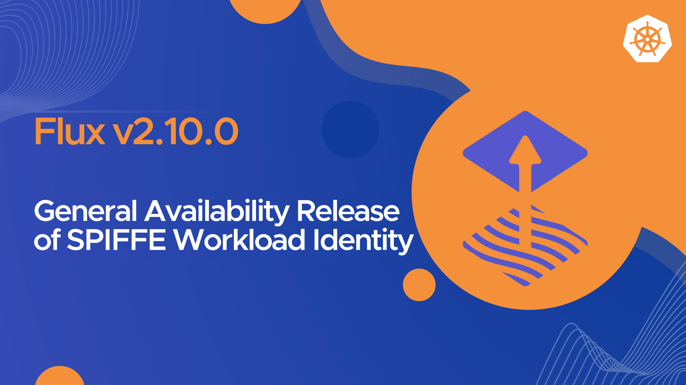

We are thrilled to announce the release of [Flux v2.10.0](https://github.com/fluxcd/flux2/releases/tag/v2.10.0)!
In this post, we highlight some of the new features and improvements included in this release.



## Highlights

Flux v2.10 brings **SPIFFE workload identity** to the GitOps Toolkit. The Flux controllers can now
authenticate each other with mutual TLS, and Flux objects can present short-lived SPIFFE
credentials to registries, secret stores, remote Kubernetes clusters and more. This release also
marks the General Availability of the Flux alerting APIs, with Event, Alert and Provider
promoted to stable v1.

In this release, we have introduced several new features to the Flux CLI and controllers:

- SPIFFE-based mutual TLS between the Flux controllers
- Object identity is now generally available (renamed from object-level workload identity), with a new SPIFFE credential provider as an alternative to the Kubernetes provider
- Cross-namespace artifact generation and tenant namespace provisioning
- The Event, Alert and Provider APIs promoted to stable v1
- New alerting providers for Zoom Team Chat, incident.io, and Mastodon
- kubectl-style TYPE/NAME arguments across the Flux CLI
- OCIRepository as a chart template for HelmRelease
- Batched image update commits and push retries for image automation

In ecosystem news, there is a new release of [Flux Operator](https://github.com/controlplaneio-fluxcd/flux-operator)
that extends the [Flux Web UI](https://fluxoperator.dev/web-ui/) with metrics and Node debugging
views, and adds resource tracing, manifest diffing, and cluster event tools to the Flux MCP Server.

## SPIFFE Integration

The headline feature of Flux v2.10 is the integration with [SPIFFE](https://spiffe.io),
specified in
[RFC-0014](https://github.com/fluxcd/flux2/blob/main/rfcs/0014-advanced-support-for-short-lived-cryptographic-material/README.md).
The RFC describes how Flux uses short-lived cryptographic material instead of static secrets, both
for communication between the controllers and for identifying Flux objects with external systems.

The SPIFFE Workload API must be configured for any of the SPIFFE features in Flux,
including object identity. Object is powered by the SPIFFE Broker API, but for
a Flux controller to connect to this API it first needs to acquire its own X509-SVID
from the SPIFFE Workload API.

### Inter-controller mTLS

Starting with this release, the Flux controllers can authenticate each other with mutual TLS using
X509-SVIDs issued by a SPIFFE Workload API such as SPIRE. Each traffic type is
enabled independently: artifact fetching from source-controller and source-watcher, internal event
delivery to notification-controller, and external webhooks also to notification-controller. You
configure the Workload API socket and the SPIFFE IDs each controller authorizes via controller
flags, and the controller Services now expose an HTTPS port for this purpose.

This hardens the trust boundaries inside the cluster: a workload that reaches a controller's
Service can no longer fetch artifacts or forge events unless it presents an authorized SPIFFE
identity. See the
[inter-controller mTLS documentation](/flux/installation/configuration/intercontroller-mtls/) for
the controller flags and an example configuration.

### Object identity

Object-level workload identity, introduced in Flux 2.6 as a feature gate, is now generally
available under a new name: **object identity**. Workload identity now refers exclusively to
identities assigned to the Flux controllers, while object identity refers to identities assigned
to individual Flux objects through `.spec.serviceAccountName`. The `ObjectLevelWorkloadIdentity`
feature gate is retired; the feature is always enabled, and setting the gate will only print
a startup log to inform you that the gate is no longer needed and has no effect, you can safely
remove it from your Flux configuration.

Two credential providers can supply the credential, selected with an annotation on the
ServiceAccount: `kubernetes`, which uses the Kubernetes TokenRequest API, and the new `spiffe`
provider, which fetches a JWT-SVID from the SPIFFE Broker API. Object identity still covers
every path it covered before SPIFFE, and SPIFFE works as alternative for all those paths and
more. In addition, the `generic` provider for OCIRepository and ImageRepository now accepts
Kubernetes ServiceAccount tokens (not only SPIFFE), extending keyless authentication to any
registry that accepts JWTs, such as Zot:

```yaml
apiVersion: source.toolkit.fluxcd.io/v1
kind: OCIRepository
metadata:
  name: app
  namespace: apps
spec:
  interval: 5m
  url: oci://registry.example.com/app
  provider: generic
  serviceAccountName: registry-puller
  ref:
    tag: latest
---
apiVersion: v1
kind: ServiceAccount
metadata:
  name: registry-puller
  namespace: apps
  annotations:
    credential.auth.fluxcd.io/provider: kubernetes
    credential.auth.fluxcd.io/type: jwt
    # Optional. Defaults to the registry host from .spec.url.
    credential.auth.fluxcd.io/audiences: registry.example.com
```

See the [object identity documentation](/flux/integrations/object-identity/) for the full
annotation reference.

{}
The default Flux RBAC no longer grants the `create` verb on the `serviceaccounts/token` resource.
If you use object identity with the `kubernetes` credential provider on source-controller,
notification-controller, image-reflector-controller, or image-automation-controller, and you rely
on the default RBAC, you must bind a ClusterRole with this permission to the controller
ServiceAccounts before upgrading. The required ClusterRole and ClusterRoleBinding are documented
in [fluxcd/flux2#6139](https://github.com/fluxcd/flux2/pull/6139).
{}

## Multi-tenant artifact generation

The ArtifactGenerator API from source-watcher can now generate artifacts across namespaces.
Setting `.spec.artifacts[].namespace` writes the resulting ExternalArtifact into another
namespace, with authorization checked explicitly: the ServiceAccount named in
`.spec.serviceAccountName` must have permission to manage ExternalArtifacts in each target
namespace, verified with a SubjectAccessReview. One generator in a platform namespace can fan out
configuration to many tenant namespaces, each with its own content-hashed revision.

Building on this, the new `.spec.managedNamespaces` feature can provision and manage the
namespaces targeted by generated artifacts. Allowed namespace names are bounded by CEL
expressions, pruning of no-longer-targeted namespaces is opt-in, and namespace labels and
annotations can be sourced from a metadata file inside the source artifact. Together with the Flux
Operator ResourceSet API, this makes end-to-end tenant onboarding a declarative, single-source
operation. Note that namespace management requires granting the source-watcher ServiceAccount
additional cluster-scoped RBAC, documented in the
[ArtifactGenerator specification](/flux/components/source/artifactgenerators/).

## Alerting APIs promoted to v1

This release marks the General Availability (GA) of the Flux alerting APIs. The following APIs
have been promoted to stable v1, joining Receiver which was already GA:

- [Alert](/flux/components/notification/alerts/)
- [Provider](/flux/components/notification/providers/)

The `v1beta3` API is still served but deprecated and will be removed in a future release. The v1
API drops fields that were deprecated in v1beta3: `Alert.spec.summary` is replaced by
`Alert.spec.eventMetadata.summary`, `Provider.spec.interval` is removed, and TLS and proxy
settings move out of `secretRef` into the dedicated `certSecretRef` and `proxySecretRef` fields.

The `flux migrate` command automates this upgrade. Crucially, it does this for both the
resources stored in your cluster and for the manifests in your Git repositories:

```shell
# migrate the custom resources stored in etcd to the latest API versions
flux migrate

# migrate the manifests in a Git checkout (YAML comments are preserved)
flux migrate -f ./clusters/production
```

Under the hood, the controllers have also migrated to v1 of the Flux Event API. Events now carry
an `action` field identifying the reconcile stage that produced them, such as `Fetching`,
`Validating`, or `Reconciling`, which makes event filtering and routing more precise.

### New alerting providers

Flux v2.10 adds three new Provider types to notification-controller:

- **Zoom Team Chat** (`type: zoom`) sends events as rich messages through an incoming webhook
chatbot.
- **incident.io** (`type: incident.io`) posts to an incident.io HTTP alert source. Error events
fire alerts and recovery events resolve them, with the involved object's UID used as the
deduplication key, so a recovered Kustomization automatically resolves its own alert.
- **Mastodon** (`type: mastodon`) posts events as statuses on a Mastodon account, with idempotency
keys to avoid duplicate posts.

```yaml
apiVersion: notification.toolkit.fluxcd.io/v1
kind: Provider
metadata:
  name: incidentio
  namespace: flux-system
spec:
  type: incident.io
  secretRef:
    name: incidentio-alert-source
```

This release also improves the existing providers: Opsgenie alerts set a deterministic alias so
repeated events deduplicate, Bitbucket Cloud API tokens are supported for commit statuses, and
proxy and TLS settings are now honored by every notifier.

## Flux CLI improvements

The Flux CLI now accepts kubectl-style `TYPE/NAME` arguments, including plural and short names,
and multiple names per command. Commands copy-pasted from your kubectl history now just work:

```shell
# get a HelmRelease by short name
flux get hr/podinfo

# reconcile two Kustomizations at once
flux reconcile ks/apps ks/infra

# suspend an ArtifactGenerator
flux suspend ag/monorepo-apps
```

This works across `flux get`, `reconcile`, `suspend`, `resume`, `delete`, and `export`. The
`suspend`, `resume`, and `reconcile` commands also gain support for ArtifactGenerator, rounding
out CLI coverage for source-watcher.

Other CLI additions in this release:

- `flux create image update --policy-change-delay` configures the new commit batching behavior of
image-automation-controller.
- `flux create secret githubapp --app-client-id` supports GitHub App Client IDs.
- `flux push|build|diff artifact --add-ignore-paths` appends patterns to the default ignore list
instead of replacing it.
- `flux plugin search --digests` prints the SHA256 digest of each plugin binary per platform.

The CLI output is also hardened against terminal escape sequence injection from cluster-sourced
strings, and `flux envsubst` no longer silently drops input on lines longer than 64KiB.

## Helm improvements

The HelmRelease chart template now supports `OCIRepository` through the new `.spec.chart.kind`
field. Instead of referencing a separately managed source with `.spec.chartRef`, a HelmRelease can
declare the OCIRepository inline, and helm-controller creates and manages that object in the
release namespace:

```yaml
apiVersion: helm.toolkit.fluxcd.io/v2
kind: HelmRelease
metadata:
  name: podinfo
  namespace: default
spec:
  interval: 15m
  chart:
    kind: OCIRepository
    spec:
      url: oci://ghcr.io/stefanprodan/charts/podinfo
      ref:
        semver: '6.5.*'
  values:
    replicaCount: 2
```

With this setup, chart version and values changes are atomic (a single object to edit and revert),
while the release still upgrades automatically when the OCIRepository artifact changes.

Remote cluster authentication with `.spec.kubeConfig.configMapRef` now participates in object
identity: the ServiceAccount named in the referenced ConfigMap can use the `kubernetes` or
`spiffe` credential provider through its annotations.

This release also fixes several long-standing issues: chart sources are now fetched in dependency
order, releases stuck in the `uninstalling` state are unlocked, and a failed rollback after a
canceled health check is resolved. helm-controller is now built with Helm 4.3.1.

## Source improvements

GitHub App authentication now accepts the app's Client ID as an alternative to the numeric App
ID, for both GitRepository and ImageUpdateAutomation. GitHub surfaces this Client ID in
the app settings, so new setups can copy it directly; set the `githubAppClientID` key in the
Secret instead of `githubAppID`.

Source signature verification now reacts to key rotation. Previously, rotating or revoking a
verification key left a stale `SourceVerified` condition until the next revision change. The
controller now stores a fingerprint of the verification material in
`.status.sourceVerificationFingerprint` on GitRepository and OCIRepository, and re-runs
verification when the keys in the referenced Secrets change, even if the revision did not.

For OCI artifacts, the `org.opencontainers.image.revision` annotation (the Git SHA stamped by
`flux push artifact`) is now forwarded in events as `originRevision`, so alerting and commit
status providers can trace an artifact back to the commit that produced it. The ExternalArtifact
API also gains `.status.exportedInputs`, which lets third-party source controllers expose
structured data to consumers such as the Flux Operator ResourceSet.

## Kustomize improvements

kustomize-controller gains new recovery and decryption capabilities in this release.

Files encrypted with SOPS comment regexes (`--encrypted-comment-regex` and
`--unencrypted-comment-regex`) now decrypt correctly. The kustomize build inherently drops these
YAML comments that SOPS relies on, so the controller now decrypts every value in the SOPS
encrypted format and leaves the rest untouched.

OpenBao and HashiCorp Vault authentication for SOPS transit-engine decryption can now be
configured per tenant with ServiceAccount annotations, replacing the operator-managed
`--sops-vault-configmap` flag. Combined with the `spiffe` credential provider, a tenant can
decrypt secrets with its own Vault role and no static token:

```yaml
apiVersion: v1
kind: ServiceAccount
metadata:
  name: sops-identity
  namespace: apps
  annotations:
    credential.auth.fluxcd.io/provider: spiffe
    credential.auth.fluxcd.io/type: jwt
    credential.auth.fluxcd.io/audiences: https://openbao.example.com
    transit-engine.auth.fluxcd.io/login-path: auth/jwt-spiffe/login
    transit-engine.auth.fluxcd.io/role: sops-spiffe
```

A new `--override-manager-before-dry-run` flag helps recover objects stuck under stale field
managers. When a foreign manager co-owns a required field in a way that makes the server-side
apply dry-run fail on every reconcile, the only fix used to be hand-editing `managedFields`. The
new flag reclaims ownership from the named managers before the dry-run. It is a recovery tool: use
it to recover the objects, then remove it.

## Image automation improvements

The ImageUpdateAutomation API gains `.spec.policyChangeDelay`, which defers the automation run
after an ImagePolicy change so that updates arriving within the delay window land in a single
commit instead of one commit per image. This cuts down commit noise when many images roll at once,
for example after a monorepo CI fan-out.

The new `GitPushRetryOnFailure` feature gate retries a rejected push on top of the latest remote
state with exponential backoff, instead of failing the reconciliation. This helps busy
repositories where humans and automation push to the same branch.

Commit message templates gain `.Changed.Summary`, which renders one line per image update, and
template ordering is now deterministic, so the same update set always produces the same commit
message. This fixes unstable Gerrit Change-Ids.

In image-reflector-controller, the Flux artifact storage backend is now the default tag database,
replacing the embedded BadgerDB. Image tags are persisted in the same storage layout used by the
other Flux controllers.

{}
Existing BadgerDB data is not migrated to the new backend. After the upgrade, the tag database
starts empty and every ImageRepository performs a one-time scan of its registry. To keep using
BadgerDB, set `--feature-gates=FluxStorage=false` on image-reflector-controller.
{}

## Ecosystem News

### Flux MCP Server and Web UI

The latest releases of [Flux Operator](https://github.com/controlplaneio-fluxcd/flux-operator)
expand the Flux MCP Server with new tools for AI assistants: tracing a Kubernetes resource back
through the GitOps pipeline, diffing manifests against cluster state, reading cluster events,
and streaming workload logs. These read-only tools enable agents to trace resources during
incidents and perform diffs to verify changes. The server has also migrated to the stateless
MCP specification.

The [Flux Web UI](https://fluxoperator.dev/web-ui/) adds new views for understanding cluster-wide
and workload-specific metrics. A new page has been added to debug Node issues, and identify
bursting workloads. Health across a Kustomization or HelmRelease Inventory can now be shown
per-resource, and health considers CEL health check expressions.



Get started by installing the latest version of Flux Operator and following the
[Flux Web UI documentation](https://fluxoperator.dev/web-ui/).

## Supported Versions

Flux v2.7 has reached end-of-life and is no longer supported.

Flux v2.10 supports the following Kubernetes versions:

| Distribution | Versions         |
| :------------ | :---------------- |
| Kubernetes   | 1.35, 1.36, 1.37 |
| OpenShift    | 4.22             |

> **Enterprise support** Note that the CNCF Flux project offers support only for the latest three minor versions of Kubernetes.
> Backwards compatibility with older versions of Kubernetes and OpenShift is offered by vendors such as [ControlPlane](https://control-plane.io/enterprise-for-flux-cd/) that provide enterprise support for Flux.

## Upgrade Procedure

No APIs have been removed in Flux v2.10. The `notification.toolkit.fluxcd.io/v1beta3` API is
deprecated and will be removed in a future release; migrate your Alerts and Providers to v1 using
the [flux migrate](/flux/cmd/flux_migrate/) command.

This release contains the following breaking changes, please review them before upgrading:

- The default RBAC no longer grants `create` on `serviceaccounts/token`. Object identity users of
the `kubernetes` credential provider on source-controller, notification-controller,
image-reflector-controller, and image-automation-controller must bind a ClusterRole with this
permission before upgrading ([fluxcd/flux2#6139](https://github.com/fluxcd/flux2/pull/6139)).
- image-reflector-controller switches its default tag database to Flux artifact storage. Existing
BadgerDB data is not migrated, and all ImageRepositories perform a one-time registry re-scan
after the upgrade. Opt out with `--feature-gates=FluxStorage=false`.
- Converting Alerts and Providers from `v1beta3` to `v1` drops the deprecated
`Alert.spec.summary` and `Provider.spec.interval` fields, static JWT authentication for Azure
Event Hub, and TLS or proxy settings configured through `secretRef`.

{}
We have published a dedicated step-by-step upgrade guide, please follow the instructions from [Upgrade Procedure for Flux v2.7+](https://github.com/fluxcd/flux2/discussions/5572).
{}

## Over and out

If you have any questions or simply just like what you read and want to get involved,
here are a few good ways to reach us:

- Join our [upcoming dev meetings](https://fluxcd.io/community/#meetings).
- Talk to us in the #flux channel on [CNCF Slack](https://slack.cncf.io/).
- Join the [planning discussions](https://github.com/fluxcd/flux2/discussions).
- Follow [Flux on Twitter](https://twitter.com/fluxcd), or join the
[Flux LinkedIn group](https://www.linkedin.com/groups/8985374/).
